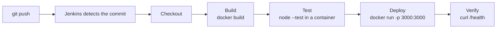

# jenkins-cicd-pipeline

A simple **Jenkins pipeline (Jenkinsfile)** that automatically **builds, tests and deploys** a small Node.js web
application as a **Docker container**. The pipeline starts by itself whenever a new commit is pushed to this repository.

> DevOps Internship - Task 2: Create a Simple Jenkins Pipeline for CI/CD

## Tools used

| Tool | Purpose |
|---|---|
| Jenkins | Automation server that runs the pipeline (installed on a Google Cloud VM) |
| Docker | Builds the image, runs the tests in a clean container and runs the deployed app |
| Git / GitHub | Source code and the `Jenkinsfile` |
| Node.js 24 | Runtime of the sample app and its automated tests |

## Pipeline overview



| Stage | What it does |
|---|---|
| **Checkout** | Gets the code from GitHub and prints the last commit |
| **Build** | `docker build` creates the image `jenkins-demo-app:<build number>` (also tagged `latest`) |
| **Test** | Runs the 4 automated tests with `node --test` inside a `node:24-alpine` container |
| **Deploy** | Removes the old container and starts the new one on port 3000 with the build number |
| **Verify** | Calls `/health` until the app answers; the stage fails (and the build is red) if it does not |

If any stage fails, the next stages do not run. A failed **Test** stage means nothing gets deployed.

**Trigger:** the `Jenkinsfile` contains `pollSCM('H/2 * * * *')`, so Jenkins checks the repository every
2 minutes and starts a build for every new commit. (For an instant trigger use a GitHub webhook together with the
`githubPush()` trigger, see the comment in the `Jenkinsfile`.)

## Repository structure

```
jenkins-cicd-pipeline/
├── Jenkinsfile              # the declarative pipeline
├── server.js                # the web application
├── test/app.test.js         # automated tests (Node.js built-in test runner)
├── package.json
├── Dockerfile               # image definition
├── .dockerignore
├── .gitignore
├── docs/
│   ├── INTERVIEW_QA.md      # answers to the interview questions of the task
│   └── screenshots/         # evidence of the pipeline
└── README.md
```

## The application

| Route | Response |
|---|---|
| `/` | HTML page that shows the **Jenkins build number** of the deployed version |
| `/health` | `{"status":"ok"}` (used by the Verify stage and the Docker `HEALTHCHECK`) |
| `/api/info` | JSON with app name, version, build number and Node.js version |

## How to reproduce

1. **VM:** create a Google Cloud VM (Ubuntu, e2-medium). Open the firewall for TCP **8080** (Jenkins) and **3000** (the app).
2. **Install Java 21, Jenkins and Docker** on the VM. Install `git` too.
   Give Jenkins access to Docker: `sudo usermod -aG docker jenkins` and `sudo systemctl restart jenkins`.
3. **Set up Jenkins:** open `http://<VM_IP>:8080`, unlock it, install the suggested plugins, create the admin user.
4. **Create the job:** *New Item* > name `jenkins-demo-pipeline` > **Pipeline** > Definition **Pipeline script from SCM** >
   SCM **Git** > this repository URL > branch `*/main` > Script Path `Jenkinsfile` > Save.
5. Click **Build Now** once (this registers the trigger from the `Jenkinsfile`).
6. **Commit a change** to the repository. Within about 2 minutes Jenkins starts a new build by itself.
7. Open `http://<VM_IP>:3000` to see the deployed app and its build number.

## Run it locally

```bash
npm test                       # run the tests
npm start                      # http://localhost:3000

docker build -t jenkins-demo-app .
docker run -d -p 3000:3000 --name jenkins-demo-app jenkins-demo-app
curl http://localhost:3000/health
```

## Screenshots

### 1. GCP VM Instance


### 2. Jenkins Initial Setup


### 3. Jenkins Plugin Installation


### 4. Jenkins Dashboard


### 5. GitHub Repository


### 6. Successful Pipeline Console Output


### 7. Jenkins Pipeline Stage View


### 8. Jenkins Build History


### 9. Deployed Application


### 10. First Build Console Output


### 11. First Build Stage View


### 12. First Build Job Page


### 13. GCP VM Configuration


### 14. Jenkins Node Status


### 15. GCP Firewall Rule


## Pipeline Result

The Jenkins CI/CD pipeline successfully builds the Docker image, runs automated tests, deploys the application on port 3000, and verifies application health.

The successful pipeline execution is confirmed by `Finished: SUCCESS` in the Jenkins Console Output.

## Automatic Trigger

A GitHub commit triggers the Jenkins pipeline automatically. Build History and Stage View can be used to verify the triggered build and its result.

## Interview questions

Short answers are in [docs/INTERVIEW_QA.md](docs/INTERVIEW_QA.md).

## Notes

- The pipeline uses only free tools (Jenkins, Docker, GitHub).
- The repository is public, so Jenkins needs no credentials to clone it.
- Never share the Jenkins admin password or expose Jenkins without a login.
